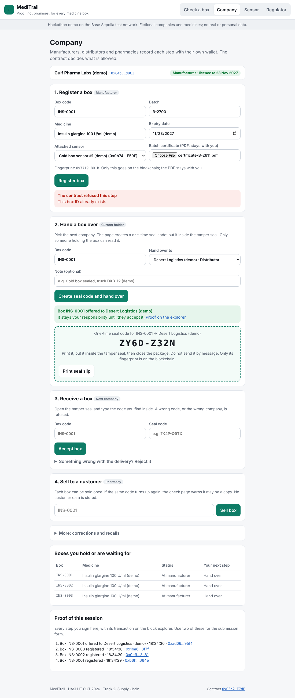

# MediTrail

**Proof, not promises, for every medicine box.**
HASH IT OUT 2026 · Track 2: Supply Chain · Base Sepolia

MediTrail tracks temperature-sensitive medicine (insulin, vaccines) from the factory to the customer.
Ordinary blockchain trackers store whatever people type in. MediTrail checks it:

- **Two-sided handovers.** The holder *offers* a box to a named company; custody moves only when that company *accepts*.
- **Proof of possession.** Each handover has a one-time **seal code** packed inside the tamper seal. Only its fingerprint is on chain; the receiver must type the code to accept, so nobody can claim a box they never held.
- **Sensor-signed temperatures.** Readings must carry the signature of the sensor attached to the box. One reading outside 2–8 °C locks the box for good.
- **Copy detection.** A box can be sold once. A second scan of the same code shows *Already sold once*: its code may have been copied.
- **Certificate fingerprints.** Lab certificates stay with the company; anyone given the PDF can check in the browser that it is the original.
- **Batch recall in one transaction**, and **licences that expire** on their own.

Anyone can scan the QR code on a box and get a plain verdict, with no wallet and no account:
*Genuine and safe · Genuine, still on its way · Already sold once · Do not use: temperature breach · Recalled · Expired · Unknown code*.

All data is fictional. No real names, no patient data, no real money.

| Check page (phone) | Temperature breach | Seal code handover |
| --- | --- | --- |
|  |  |  |

---

## What's in this repo

```
contracts/MediTrail.sol    the smart contract (Solidity 0.8.24)
web/                       the website: plain HTML + JavaScript, no build step
  index.html               four screens: Check a box · Company · Sensor · Regulator
  app.js                   talks to the contract (ethers v6)
  config.js                <-- paste your contract address here after deploying
  abi.js                   generated from the contract by `npm run compile`
  vendor/                  ethers.js and a QR code library, saved locally
test/test_meditrail.py     20 contract tests: every rule and every refusal (Python, web3.py)
tools/compile.js           compiles the contract, writes build.json and web/abi.js
tools/e2e.js               browser test of the full demo story on a local chain (33 checks)
docs/NOTE.md               the one-page note for the submission form
docs/DEMO.md               demo-day setup and the 5-minute pitch script
docs/screenshots/          screenshots from the browser test
.github/workflows/pages.yml publishes web/ to GitHub Pages
```

---

## 1. Deploy the contract (Remix + MetaMask, about 10 minutes)

1. MetaMask: switch to **Base Sepolia** (chain ID 84532) and get test ETH from the organisers' faucet link.
   The account you deploy from becomes the **regulator** (admin).
2. Open https://remix.ethereum.org, create `MediTrail.sol`, paste `contracts/MediTrail.sol`.
3. **Compile tab:** compiler **0.8.24**, open *Advanced configurations*, tick **Enable optimization** (runs **200**). Press Compile.
   *The optimizer is required:* without it the contract is over the 24 KB size limit and deployment fails.
4. **Deploy tab:** Environment = *Injected Provider – MetaMask*, press **Deploy**, confirm in MetaMask.
5. Copy the deployed contract address and paste it into `web/config.js` → `contractAddress: "0x..."`.
   (To try a deployment without editing: open the site with `?contract=0x...`.)

## 2. Set up the demo companies and the sensor

Create MetaMask accounts for each company and send each a little test ETH from the regulator account.
Open the site → **Sensor** tab: it shows the simulated sensor's address (the key lives in that browser).
Then in the **Regulator** tab, connected as the regulator, approve:

| Wallet | Name | Role |
| --- | --- | --- |
| Account 2 | Gulf Pharma Labs (demo) | Manufacturer |
| Account 3 | Desert Logistics (demo) | Distributor |
| Account 4 | Al Noor Pharmacy (demo) | Pharmacy |
| Sensor tab address | Cold box sensor #1 (demo) | Sensor |

The sensor never needs test ETH: the carrier's wallet relays its signed readings.
Sign sensor readings from the **same browser** whose address you approved.

## 3. Run the website

The site must be served over http (not opened as a file) because it uses JavaScript modules.

```bash
cd web && python -m http.server 8000      # then open http://localhost:8000
```

**Publish for judges (free):** in GitHub → *Settings → Pages → Build and deployment*, choose **GitHub Actions**.
Every push to `main` then publishes `web/` (see `.github/workflows/pages.yml`).
QR codes point at whatever address the site is opened from, so print final labels from the published site.

## 4. Tests (no test ETH needed)

```bash
npm install                     # solc, ethers, ganache, playwright-core
npm run compile                 # writes build.json and web/abi.js
pip install "web3[tester]" pytest
python -m pytest test/ -q       # 20 passed
npm run e2e                     # full demo story in headless Chrome; set CHROME_PATH if needed
```

---

## The rules the contract enforces

| Attempt | The contract says |
| --- | --- |
| Anyone but the regulator approves a company | Only the regulator can approve companies |
| A non-manufacturer registers a box | Only an approved manufacturer can register a box |
| Registering an existing box code | This box ID already exists |
| Registering with an unapproved sensor | Attach a sensor the regulator has approved |
| Any step after a company's licence ends | Your licence has expired |
| Manufacturer hands a box straight to a pharmacy | Out of order: a box must go to a distributor next |
| Distributor hands a box to another distributor | Out of order: a box must go to a pharmacy next |
| Someone who is not holding the box offers it | Only the company holding this box can hand it over |
| Any company other than the named receiver accepts | This box was not offered to you |
| Accepting with the wrong seal code | Seal code does not match |
| A reading not signed by the box's sensor | Reading not signed by this box's sensor |
| Replaying an old reading | Reading is out of date |
| Moving or selling a box after a breach | This box had a temperature breach and is blocked |
| Moving or selling a box in a recalled batch | This batch has been recalled |
| Selling a box twice | This box was already sold |
| Selling a box the pharmacy never accepted | Only the pharmacy holding this box can sell it |
| Selling an expired box | This box has expired and cannot be sold |
| Recall by anyone but the regulator or the batch's maker | Only the regulator or this batch's manufacturer can recall it |
| Correction from a wallet that never handled the box | Only a company that handled this box can add a correction |

The website has **no rules of its own**. Every button is always clickable; the page first asks the
contract with a free simulated call and shows its answer. Calling the contract directly from Remix
gets exactly the same refusals. Even the public verdict (`verdictOf`) is decided by the contract.

## How the two cryptographic checks work

- **Seal code:** the sender stores `keccak256(code)` when it offers. The receiver sends `code` when it accepts and the contract recomputes the hash. Each handover uses a new code, because a revealed code becomes public.
- **Sensor signature:** the sensor signs `keccak256(contract, keccak256(boxId), temperature, time)` as a standard Ethereum signed message. The contract recovers the signer with `ecrecover` and compares it with the sensor registered for the box. Readings must be newer than the last one, so old readings cannot be replayed.

Temperatures are stored in tenths of a degree (54 = 5.4 °C) because Solidity has no decimals.

## Honest limits

No software can stop two companies who collude, or someone who moves the sensor away from the box.
What MediTrail guarantees is that every step is signed by a named company's wallet and can never be
edited, so a false claim is permanent and traceable. In production the sensor would be a sealed data
logger with its key inside the device, and a health regulator would hold the admin role.
